# Packaging, releases and auto-update

One chain: **GitHub Actions builds → GitHub Release → `npm run mirror` rsyncs it into the
company's static directory → the app's electron-updater and the platform download page both
read that directory**.

```mermaid
flowchart LR
  subgraph dev["Developer"]
    V["version + CHANGELOG<br/>apps/shell/package.json"]
  end

  subgraph ci["GitHub Actions · Dist (macOS + Windows)"]
    M["mac job<br/>npm run dist -- --target mac<br/>arm64 dmg + zip"]
    W["win job<br/>npm run dist -- --target win<br/>NSIS exe"]
    R["release job<br/>scripts/release-gh.mjs"]
    M --> R
    W --> R
  end

  subgraph gh["GitHub Release · ponytailer/genoffice"]
    A["dmg / zip / exe<br/>latest-mac.yml / latest.yml<br/>SHA256SUMS.txt"]
  end

  subgraph mirror["npm run mirror (laptop or server)"]
    D["gh release download"]
    V2["verify SHA256SUMS<br/>forward-only guard"]
    H["rehash feed sha512<br/>from the served bytes"]
    J["latest.json / releases.json"]
    S["~/.cache/genoffice/office-mirror<br/>(keeps N previous versions)"]
    D --> V2 --> H --> J --> S
  end

  subgraph srv["nginx static dir<br/>ai-staff.folidaymall.com/download/office/"]
    F["latest.yml · latest-mac.yml<br/>latest.json · releases.json"]
    P["CMLG-Office-*.dmg / .zip / Setup-*.exe<br/>SHA256SUMS.txt"]
  end

  subgraph client["installed CMLG Office"]
    U["updater.ts<br/>15s after launch, then every 4h"]
    DL["download (Range resume)"]
    I["restart &amp; install"]
    N["no self-update<br/>→ download page"]
    U --> DL --> I
    U -.-> N
  end

  subgraph plat["platform page (separate work)"]
    PAGE["first install / mac manual update<br/>reads latest.json"]
  end

  V -->|tag v0.1.x| M
  R --> A
  A --> D
  S -->|rsync --delay-updates| F
  S --> P
  F -->|GET latest*.yml| U
  P -->|GET installer| DL
  F --> PAGE
  P --> PAGE
```



## Directory layout (server = local state dir)

One **flat** directory serves both purposes, because

- the generic provider resolves its feed as `<base>/latest.yml` (Windows) and
  `<base>/latest-mac.yml` (macOS);
- the app's manual-install fallback rebuilds links as `<base>/<installer name>`
  (`manualDownloadUrlFor` in `apps/shell/src/main/updater.ts`, with `<base>` read from the
  packaged `resources/app-update.yml`).

```
https://ai-staff.folidaymall.com/download/office/
├── latest.yml                  Windows update feed
├── latest-mac.yml              macOS update feed
├── latest.json                 download-page manifest (generated here, see below)
├── releases.json               version history for that page
├── CMLG-Office-0.1.2-arm64.dmg macOS first install / manual reinstall
├── CMLG-Office-0.1.2-arm64.zip Squirrel.Mac update payload (not a link to offer)
├── CMLG-Office-Setup-0.1.2.exe Windows install + update
└── SHA256SUMS.txt
```

`.blockmap` files are not mirrored: the app sets
`autoUpdater.disableDifferentialDownload = true`, so every update is a full download.

## Repo variables and secrets

`Dist` reads these at package time (`gh variable set <NAME> --body <value>`):

| Name                     | Purpose                                                                                                                                                  | State                                                      |
| ------------------------ | -------------------------------------------------------------------------------------------------------------------------------------------------------- | ---------------------------------------------------------- |
| `UPDATE_URL`             | feed base URL baked into `resources/app-update.yml`; without it there are **no** feed files and no auto-update                                           | to set: `https://ai-staff.folidaymall.com/download/office` |
| `DOWNLOAD_URL`           | baked into `package.json` as `genofficeDownloadPage.url`; where a build that cannot self-update sends the user. Unset falls back to the same URL in code | optional                                                   |
| `WIN_SIGN_MODE`          | `test` / `production` runs `scripts/win-sign.cjs`                                                                                                        | unset (unsigned)                                           |
| `DIST_MIRROR`            | `off` downloads Electron/cargo from the official sources                                                                                                 | unset (China mirrors)                                      |
| `MAC_CSC_LINK` & friends | macOS signing + notarization                                                                                                                             | **unset**                                                  |

## Publishing one version

```bash
# 1. bump the version + CHANGELOG (apps/shell/package.json, CHANGELOG.md)
# 2. commit, tag, let CI package and create the release
git tag v0.1.2 && git push origin v0.1.2

# 3. mirror the release into the static directory (from a machine that can ssh in)
export OFFICE_MIRROR_DEST=deploy@ai-staff:/var/www/ai-staff/download/office
npm run mirror -- --tag v0.1.2 --dry-run   # verify + stage + print the rsync plan
npm run mirror -- --tag v0.1.2             # verify, regenerate manifests, rsync
```

`npm run mirror` (`scripts/mirror-release.mjs`), in this order:

1. `gh release download` the assets;
2. verify every installer against the release's `SHA256SUMS.txt` — for unsigned builds this is
   the only integrity signal;
3. forward-only guard: refuse to publish when the served feed is at or ahead of the candidate
   (`releaseUploadDecision` in `scripts/update-feed-utils.cjs`), unless `--force`;
4. recompute `sha512`/`size` in `latest*.yml` from the bytes actually served — a notarized and
   stapled dmg no longer matches the hash electron-builder wrote before stapling;
5. generate `latest.json` (download page) and `releases.json` (history, merged with what the
   server already has, capped at 10);
6. `rsync --delay-updates`: installers first, feed/manifest swapped in last, so no client ever
   reads a feed pointing at a file that is still uploading.

| Flag                                          | Meaning                                                                                                    |
| --------------------------------------------- | ---------------------------------------------------------------------------------------------------------- |
| `--tag v0.1.2`                                | release to mirror; default is the newest published one                                                     |
| `--dest <target>` / `OFFICE_MIRROR_DEST`      | rsync target (`user@host:/path/`); without it the run only stages locally                                  |
| `--base-url <url>` / `OFFICE_MIRROR_BASE_URL` | default `https://ai-staff.folidaymall.com/download/office`                                                 |
| `--state <dir>` / `OFFICE_MIRROR_STATE`       | local state dir, default `~/.cache/genoffice/office-mirror`                                                |
| `--dry-run`                                   | verify + stage + print the rsync plan (`-n`), upload nothing                                               |
| `--force`                                     | re-publish the same version (rebuilt artifacts) or roll back                                               |
| `--no-feed`                                   | the release has no `latest*.yml` (built before `UPDATE_URL` was set) — mirror it as a manual download only |
| `--prune`                                     | add `--delete` to rsync, removing files the state dir no longer has                                        |
| `--keep <n>`                                  | how many previous versions to retain, default 3, `0` = keep everything                                     |

## nginx

```nginx
# URL /download/office/...  →  /var/www/ai-staff/download/office/...
location /download/office/ {
    root /var/www/ai-staff;

    # Update metadata must never be cached, or clients never see a new version.
    location ~ "^/download/office/(latest(-mac)?\.yml|latest\.json|releases\.json|SHA256SUMS\.txt)$" {
        default_type application/octet-stream;
        add_header Cache-Control "no-store" always;
    }

    # Versioned installers are immutable: cache them for a year.
    location ~ "^/download/office/.*\.(dmg|zip|exe)$" {
        default_type application/octet-stream;
        add_header Cache-Control "public, max-age=31536000, immutable" always;
        gzip off;
    }
}
```

Two hard requirements:

1. **`Range` must work** (`sendfile on` is enough). The app's resumable downloader
   (`apps/shell/src/main/update-resume.ts`) needs 206 responses, so no proxy or CDN in front of
   this directory may strip `Range` / `Accept-Ranges` / `Content-Length`, compress, or rewrite
   the files.
2. **`latest*.yml` must not be cached.** Keep the feed off the CDN, or give those three names
   `no-store` / a short TTL plus a purge after every mirror.

## `latest.json` contract (for the platform page)

```json
{
  "product": "CMLG Office",
  "version": "0.1.2",
  "tag": "v0.1.2",
  "releasedAt": "2026-10-28T08:45:04.622Z",
  "notesUrl": "https://github.com/ponytailer/genoffice/releases/tag/v0.1.2",
  "checksumsUrl": "https://ai-staff.folidaymall.com/download/office/SHA256SUMS.txt",
  "files": [
    {
      "platform": "macos",
      "arch": "arm64",
      "kind": "dmg",
      "name": "CMLG-Office-0.1.2-arm64.dmg",
      "url": "…/CMLG-Office-0.1.2-arm64.dmg",
      "sha256": "9f1d…",
      "size": 192273073
    },
    {
      "platform": "macos",
      "arch": "arm64",
      "kind": "zip",
      "name": "CMLG-Office-0.1.2-arm64.zip",
      "…": "…"
    },
    {
      "platform": "windows",
      "arch": "x64",
      "kind": "exe",
      "name": "CMLG-Office-Setup-0.1.2.exe",
      "…": "…"
    }
  ]
}
```

- Offer `kind: "dmg"` as a download; `kind: "zip"` is Squirrel.Mac's payload and should not get a
  button.
- `releases.json` = `{ product, updatedAt, releases: [ …same shape, newest first, max 10 ] }`.
- Serving the files from the same origin as the page avoids CORS; otherwise add
  `Access-Control-Allow-Origin` for these two JSON files or cache them behind the platform's
  backend.

## Known limitations of the current setup

1. **v0.1.1 shipped without an update source**: `UPDATE_URL` was empty when that tag was built,
   so the installed app has no `app-update.yml` and "Check for Updates" only points at the
   download page. **v0.1.1 → v0.1.2 needs one manual install**; auto-update starts with
   v0.1.3.
2. **macOS auto-update requires signing + notarization.** Squirrel.Mac validates that the update
   carries the same signing identity as the running app and rejects unsigned packages (it looks
   like a download failure). Until `MAC_CSC_LINK`, `MAC_CSC_KEY_PASSWORD`, `APPLE_ID`,
   `APPLE_APP_SPECIFIC_PASSWORD` and `APPLE_TEAM_ID` are set, macOS users get
   "new version available → install the dmg by hand". No code change is needed once they are
   set — but **never change the signing identity afterwards**: it invalidates auto-update for
   every installed copy.
3. **Windows updates work unsigned** (electron-updater only verifies the feed's sha512); the
   price is a SmartScreen warning. `WIN_SIGN_MODE` upgrades that later.
4. **The update URL is baked into the installer**, so moving hosts means moving channels: old
   copies keep watching the old host. Keep the domain stable. A `beta` channel would need
   electron-builder to emit `beta*.yml` (the publish block pins `channel: 'latest'` today).
